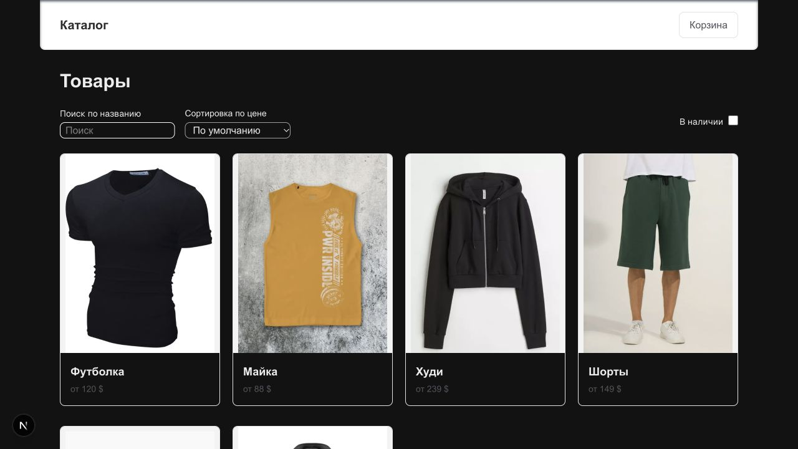
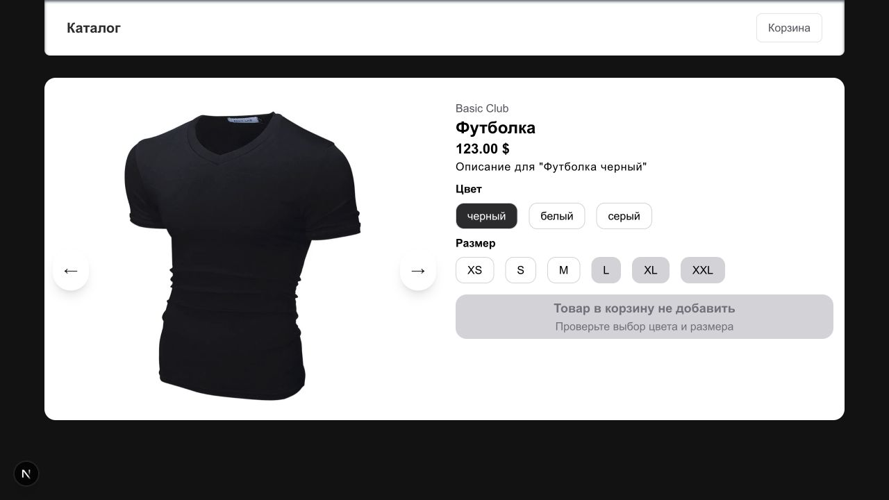
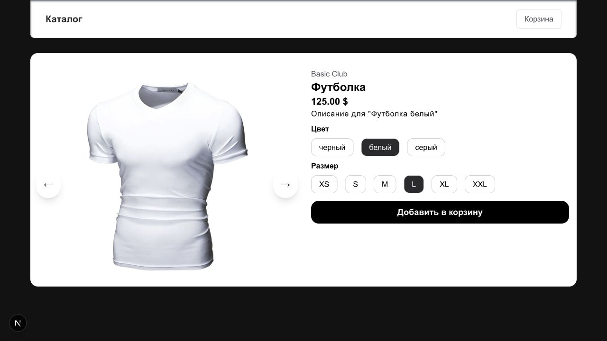
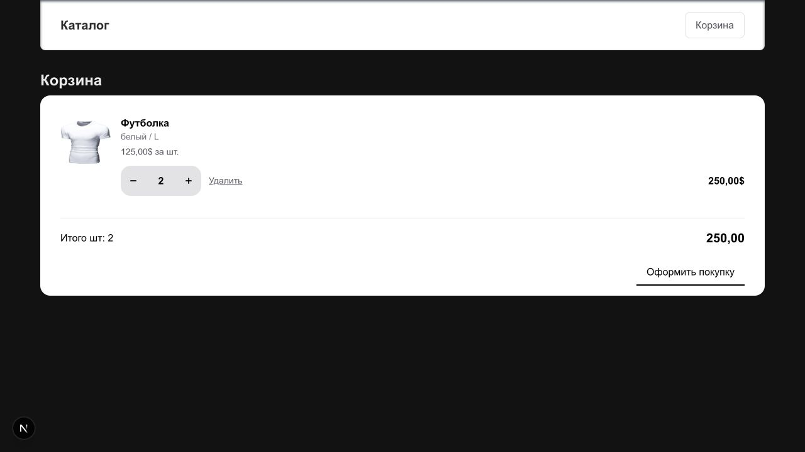
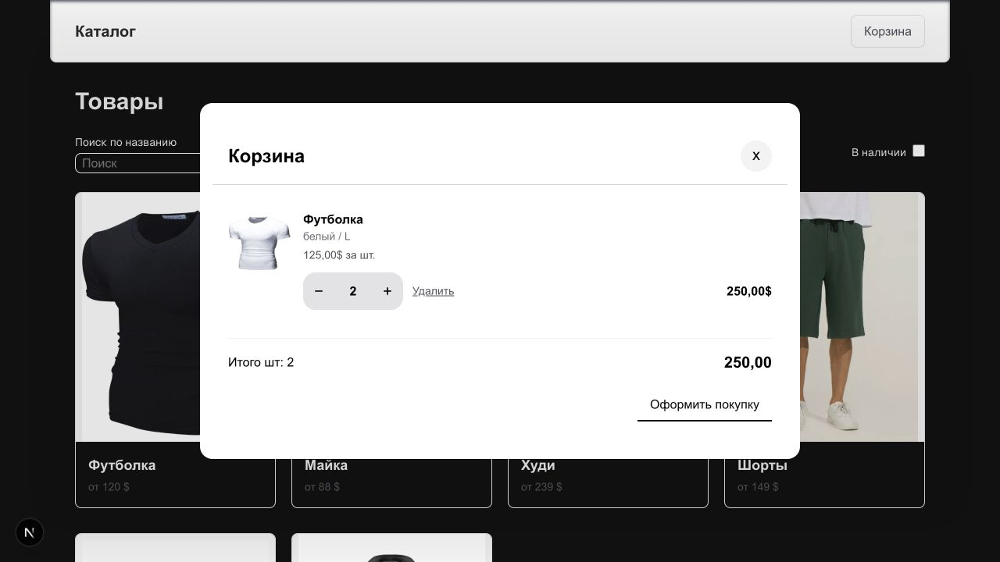
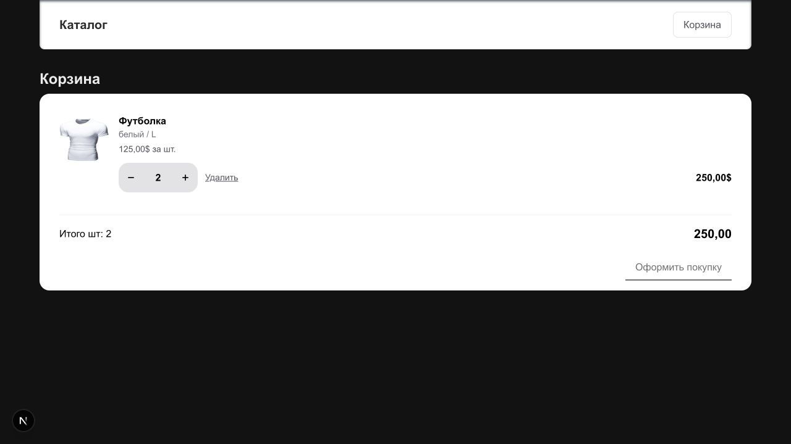

# Мини-каталог товаров

Тестовое приложение: каталог одежды, детальная страница товара и корзина. Данные о товарах берутся из `src/services/api.js` через локальный GraphQL-эндпоинт `/api/graphql`.

## Что реализовано

- **Каталог `/`:** карточки с фото, названием и минимальной ценой среди всех цветов; поиск без учёта регистра, фильтр «В наличии» и сортировка по цене в обе стороны. Товар считается доступным, если хотя бы у одного цвета есть доступный размер.
- **Товар `/products/[id]`:** галерея со стрелками без сторонних библиотек, выбор цвета и размера, цена и описание выбранного цвета. Недоступные размеры видны, но заблокированы. Для отсутствующего товара есть ссылка обратно в каталог.
- **Корзина `/cart`:** позиции различаются по комбинации товара, цвета и размера. Повторное добавление увеличивает количество. Можно менять количество и удалять позиции; отображаются цена за штуку, сумма позиции и общий итог.
- **Модалка корзины:** кнопка в шапке на главной открывает модалку поверх каталога и меняет URL на `/cart`. С карточки товара и при прямом открытии адреса показывается отдельная страница. Список и управление корзиной общие для обоих представлений.
- **Сохранение:** изменения корзины записываются через MobX `reaction` в `localStorage` под ключом `cart`. После перезагрузки восстанавливаются позиции и их количество.
- **Бонус — вариант товара в URL:** параметры `colorId` и `sizeId` обновляются при выборе и восстанавливают доступный вариант при открытии ссылки. Промокод не реализован.

Маршрут `/purchase` — демозаглушка без оформления заказа.

## Стек

- **Next.js 16 (App Router), React 19, TypeScript** — маршруты и интерфейс.
- **MobX и mobx-react-lite** — состояние каталога и корзины.
- **GraphQL Yoga и GraphQL Code Generator** — локальный API и типизированные запросы.
- **Tailwind CSS 4** — вёрстка и стили.

## Запуск

Нужен Node.js 20.9 или новее.

```bash
npm ci
npm run dev
```

Откройте [http://localhost:3000](http://localhost:3000). Для production-сборки используйте `npm run build`, затем `npm start`. После изменений GraphQL-схемы или запросов перегенерируйте типы командой `npx graphql-codegen --config codegen.ts`.

## Скриншоты

### Главная страница



### Детальная страница



### Параметры выбора в URL

Пример: [`/products/1?colorId=2&sizeId=4`](http://localhost:3000/products/1?colorId=2&sizeId=4) — белая футболка, размер L. Параметры появляются при выборе цвета и размера.



### Восстановление из localStorage

На снимке — результат после перезагрузки `/cart`: остались две белые футболки размера L и итог 250,00.



### Модалка корзины



### Страница корзины


